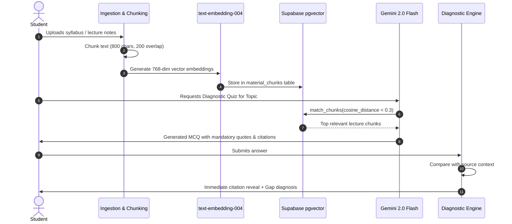

# 🔍 GapFinder AI — Intelligent Knowledge Gap Diagnosis & Revision Planning

> **"Students often study everything equally and still miss what they don’t know. Traditional study tools wait for questions, but a student cannot ask about a gap they don't know they have."**

GapFinder AI ingests a student's syllabus, textbook chapters, lecture notes, and past question papers, maps the curriculum into topics, generates diagnostic assessments grounded in their material with citations, identifies weak/medium/strong areas, and generates a personalized, time-budgeted revision plan.

---

## 🚀 Live Demo & Demo Credentials (For Judges)

- **Demo Account Email:** `demo@gapfinder.ai`
- **Demo Password:** `demo123456`
- **⚡ 1-Click Judge Preloader:** A prominent *"⚡ Preload Sample Course (Judge Mode)"* button is available on the Dashboard and Materials page. Clicking this immediately loads:
  - Official university Operating Systems (`CS301`) syllabus and lecture notes
  - Vector embeddings and indexed chunks
  - Extracted hierarchical topic tree
  - Completed diagnostic quiz assessment with citation answers
  - Pre-diagnosed Gap Report with conceptual weakness reasoning
  - Prioritized revision plan with study hours allocation

---

## 💡 Problem Statement & Core Value

Traditional AI study tools function primarily as passive **"chat with your PDF"** interfaces. They wait for students to prompt them. However:
1. Students waste hundreds of hours reviewing familiar concepts while their genuine conceptual blindspots stay untouched until exam day.
2. Students cannot formulate questions about misconceptions they are unaware of.
3. Conventional question generators test generic trivia from general LLM training data rather than the student's exact course syllabus.

**GapFinder AI flips the paradigm from passive answering to active diagnosis.**

---

## 🏗️ Architecture Overview

```mermaid
graph TB
    subgraph Client["Frontend (Next.js 15 + TypeScript + Tailwind CSS)"]
        UI["Liquid Glass UI"]
        Auth["Supabase SSR Auth"]
        Upload["Material & Syllabus Ingestion"]
        TopicMap["Curriculum Topic Tree"]
        QuizEngine["Diagnostic Quiz & Timer"]
        GapView["Gap Diagnosis & Reasoning"]
        PlanSched["Revision Plan Scheduler"]
        RAGChat["Explain-This-Topic RAG Chat"]
        Dashboard["Progress & Recharts Analytics"]
    end

    subgraph Server["Next.js Server / API Routes"]
        MatAPI["/api/materials"]
        TopAPI["/api/topics"]
        QuizAPI["/api/quiz & /api/quiz/answer"]
        GapAPI["/api/gap-analysis"]
        PlanAPI["/api/plan"]
        ChatAPI["/api/chat"]
        ProgAPI["/api/progress"]
        SeedAPI["/api/seed-demo"]
    end

    subgraph AILayer["AI Engine (Google Gemini 2.0 & RAG)"]
        GeminiFlash["Gemini 2.0 Flash"]
        GeminiEmbed["Gemini text-embedding-004"]
        Chunker["Sliding Window Chunker (800 / 200 overlap)"]
        QGen["Grounded Question Generator"]
        Evaluator["Diagnostic Answer Evaluator"]
        GapDiagnostician["Topic Gap Diagnostician"]
        PlanOptimizer["Hour-Budgeted Plan Optimizer"]
    end

    subgraph Database["Database & Vector Store (Supabase)"]
        AuthUsers["auth.users"]
        PGSQL["PostgreSQL Tables (RLS Secured)"]
        PGVector["pgvector (match_chunks 768-dim similarity)"]
        Storage["Supabase Storage (PDFs & Documents)"]
    end

    Client --> Server
    Server --> AILayer
    Server --> Database
    AILayer --> Database
```



---

## 🔬 The RAG Pipeline

GapFinder AI maintains a strict separation between **Retrieval** and **Generation**:



1. **Chunking Strategy:** Content is split into 800-character semantically bounded windows with 200-character overlap to preserve formula derivations, definitions, and cross-paragraph contexts.
2. **Embedding Model:** Google Gemini `text-embedding-004` (768 dimensions).
3. **Similarity Search:** Native PostgreSQL `pgvector` utilizing cosine distance (`<=>` operator) via the `match_chunks` stored procedure.
4. **Source Grounding & Citations:** Every question and AI explanation requires an explicit quote from the retrieved chunk so students can verify the diagnosis directly in their material.

---

## 🤖 AI Workflow Separation

To ensure absolute diagnostic accuracy and prevent model hallucination:

| AI Stage | Purpose | Grounding Technique |
|---|---|---|
| **Topic Tree Extraction** | Builds hierarchical syllabus map | Gemini extracts modules & subtopics directly from raw syllabus text |
| **Question Generation** | Generates diagnostic questions | Strictly bounded to retrieved chunks via RAG; general LLM memory is suppressed |
| **Answer Evaluation** | Explains why answer is right/wrong | References source material and identifies student misconception |
| **Gap Analysis** | Turns quiz scores into topic ratings | Evaluates performance across questions to diagnose weak (<40%), medium (40-70%), and strong (>70%) areas with explanatory reasoning |
| **Revision Plan Generation** | Builds actionable study schedule | Optimizes hours based on student time budget, giving highest priority to weak topics |

---

## ✨ Features Implemented

1. **Material Ingestion:** Support for PDF and raw text upload for Syllabi, Lecture Notes, Textbooks, and Past Question Papers.
2. **Interactive Topic Map:** Hierarchical tree with real-time health badges showing Mastery, Review Needed, or Knowledge Gap.
3. **Diagnostic Quiz Engine:** Topic selector, difficulty configuration, timer, interactive option selector, instant citation inspection, and automatic gap diagnosis.
4. **Curriculum Gap Report:** Topic-by-topic diagnostic breakdown explaining the conceptual cause of each weakness with remediation steps.
5. **Personalized Revision Plan:** Dynamic hour budgeting (input available hours before test), prioritized schedule, step-by-step activities, targeted sections, and interactive progress checklist.
6. **Explain-This-Topic Assistant:** RAG-powered conversational tutor answering strictly from uploaded materials with clickable prompt suggestions and citation blocks.
7. **Progress Dashboard:** Historical learning analytics powered by Recharts (Topic Mastery bar chart, accuracy trajectory timeline, quiz attempt log).
8. **Secure Authentication:** Supabase SSR Auth with session cookies, protected route middleware, and 1-click Judge Demo Mode.
9. **Liquid Glass Aesthetic:** Dark mode theme with glassmorphism, glowing borders, animated background orbs, and micro-interactions.

---

## 🛠️ Tech Stack

- **Framework:** Next.js 15/16 App Router (React 19, TypeScript)
- **Styling:** Tailwind CSS with custom liquid glass theme & Google Inter typography
- **Database & Auth:** Supabase (PostgreSQL + pgvector + Supabase Auth + Storage)
- **AI & LLM:** Google Gemini 2.0 Flash & Gemini `text-embedding-004`
- **Charts:** Recharts
- **Icons:** React Icons (Lucide)
- **Markdown:** React Markdown

---

## ⚙️ Local Setup Instructions

### 1. Clone the repository
```bash
git clone https://github.com/your-username/gapfinder-ai.git
cd gapfinder-ai
```

### 2. Install dependencies
```bash
npm install
```

### 3. Configure Environment Variables
Create a `.env.local` file in the root directory:
```env
NEXT_PUBLIC_SUPABASE_URL=https://your-project.supabase.co
NEXT_PUBLIC_SUPABASE_PUBLISHABLE_KEY=your-supabase-publishable-key
GEMINI_API_KEY=your-google-gemini-api-key
```

### 4. Database Setup
Execute the complete SQL script located in `supabase-schema.sql` in your Supabase SQL Editor. This will:
- Enable the `vector` extension
- Create all 10 application tables with Row Level Security (RLS)
- Install the `match_chunks` similarity search function
- Configure the `materials` storage bucket

### 5. Run Development Server
```bash
npm run dev
```
Open [http://localhost:3000](http://localhost:3000) in your browser.

---

## 🌐 Deploy to Vercel (Production Ready)

GapFinder AI is pre-configured for 1-click deployment on **Vercel**.

### Step 1: Push your code to GitHub
```bash
git add .
git commit -m "feat: ready for vercel deployment"
git push origin main
```

### Step 2: Import into Vercel
1. Log in to [Vercel](https://vercel.com) and click **"Add New Project"**.
2. Select your `gapfinder-ai` repository.
3. Keep default settings (`Framework Preset: Next.js`, `Build Command: next build`).

### Step 3: Configure Environment Variables (Hidden & Secure)
In Vercel **Project Settings > Environment Variables**, add:

| Variable Name | Description | Example / Location |
| :--- | :--- | :--- |
| `NEXT_PUBLIC_SUPABASE_URL` | Supabase Project URL | `https://ypjbmvyvemelyxfunjij.supabase.co` |
| `NEXT_PUBLIC_SUPABASE_PUBLISHABLE_KEY` | Supabase Anon / Publishable Key | Supabase Dashboard > Settings > API |
| `NEXT_PUBLIC_SUPABASE_ANON_KEY` | (Optional fallback) | Same as publishable key |
| `GEMINI_API_KEY` | Google Gemini API Key | [Google AI Studio](https://aistudio.google.com/app/apikey) |
| `NEXT_PUBLIC_APP_URL` | Production Domain | `https://your-project.vercel.app` |

> 🔒 **Security Guarantee:** All real API keys (`GEMINI_API_KEY`, etc.) are hidden in Vercel environment variables and excluded from Git commits via `.gitignore`. The Gemini key is only invoked from server-side API routes and is never sent to the client browser.

### Step 4: Click "Deploy"
Vercel will compile the Next.js production build and deploy your app with global Edge caching and serverless API execution.

---

## 🔭 Limitations & Future Enhancements

### Current Limitations
- PDF parsing currently processes text-based PDFs (scanned non-OCR PDFs require external OCR preprocessing).
- Single-student profile per session (class-wide aggregate view is currently represented as individual progress).

### Future Scalability Roadmap
1. **Teacher / Institution Portal:** Class-level heatmaps showing curriculum topics where the largest percentage of students stumble.
2. **Automated Spaced Repetition:** Timed email reminders re-testing previously weak topics at optimal retention intervals (1, 3, 7, and 14 days).
3. **Multi-Subject & Multi-Language Support:** Cross-lingual retrieval allowing students to study local curricula in their native language.
4. **LMS Integration:** Direct LTI integration with Canvas, Moodle, and Google Classroom.

---

## 📜 License
MIT License. Built for the Hackathon / Project Showcase.
